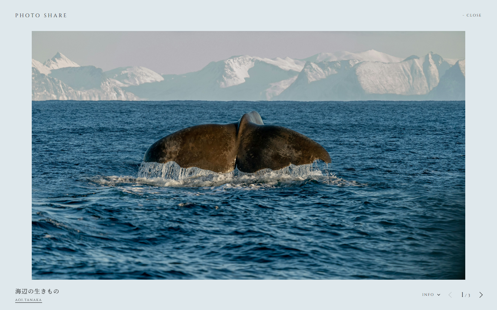
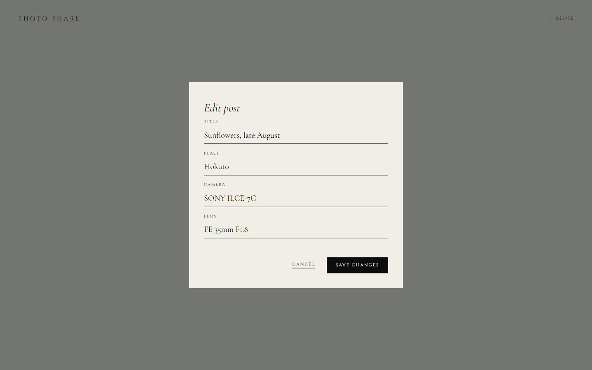
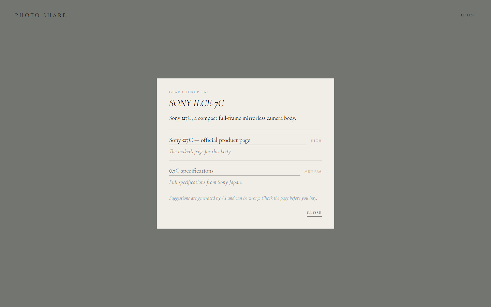

[English](./readme.md) | 日本語

# Photo Share

Photo Share は、Go、React、TypeScript、PostgreSQL で構築されたフルスタックの写真共有 Web アプリケーションです。

ユーザーは、サインアップ、ログイン、1枚または最大10枚の組写真の投稿、タイトル・場所・カメラ・レンズの追加、一度に一枚ずつ見る公開フィードの閲覧と並べ替え・絞り込み、作品の全画面表示、プロフィールの閲覧、自分の投稿の編集・削除を行えます。どのページも、表示している写真の色をまといます。

このプロジェクトには、投稿内で言及されたカメラボディやレンズの製品・仕様リンクを探すのに役立つ、AI 搭載の機材リンクアシスタントも含まれています。

## 機能

* ユーザーのサインアップとログイン
* JWT ベースの認証
* アップロード画像付きの写真投稿作成
* キャプション、撮影場所、カメラボディ、レンズのメタデータ追加
* カメラボディ・レンズを空欄にした場合、写真の EXIF データから自動入力（ブラウザで読み取るため、アップロード前に表示）
* 画像の保存前に、写真のメタデータ（GPS 位置情報を含む EXIF、XMP、IPTC）を再エンコードせずに削除
* 一度に一作品を全画面で見るフィード（スクロールに合わせて続きを読み込み）
* 索引：全作品のコンタクトシートと、並べ替え（新しい順・古い順・写真の多い順）と絞り込み（撮影者、1枚の写真・組写真）。条件は URL に残るのでリンクで共有可能
* 写真だけの投稿ページと、その下の解説（ウォールラベル）、気が散らない「暗転」表示
* プロフィール：同じリールを一人に絞り込んだもの（作品数・写真数つき）
* 投稿ごとのページの色（サーバーが写真から計算し、文字が読める明るさに調整）
* 英語と日本語（ユーザーごとに保存）
* 自分の投稿の編集と削除
* 認証が必要な操作向けの保護されたルート
* カメラ・レンズ製品候補のための AI 機材リンクアシスタント
* OpenAPI でドキュメント化されたバックエンド API

## 技術スタック

### Frontend

* React
* TypeScript
* React Router（画面遷移に View Transitions API）
* Vite
* デザイントークンによる CSS（UI キットの見た目は使わない）
* Base UI（ダイアログ、ツールチップ、トグル）、motion、Sonner、dnd-kit、NumberFlow

### Backend

* Go
* PostgreSQL
* go-jet
* goose migrations
* JWT authentication
* OpenAPI

### AI Integration

* バックエンドのみでの AI API 連携
* 機材リンク候補用の構造化 JSON レスポンス

### Development Tools

* Git / GitHub
* VS Code
* API テスト用の curl

## アーキテクチャ

このプロジェクトは、フロントエンド、バックエンド、データベース、OpenAPI 契約に分かれています。

```text
photo-share/
  backend/
    cmd/server/              # Go サーバーのエントリーポイント
    internal/handler/        # HTTP ハンドラー
    internal/service/        # ビジネスロジック
    internal/repository/     # データベースクエリ
    internal/middleware/     # 認証、CORS、ロギング、リカバリー
    internal/db/             # 生成されたデータベースモデル
    internal/dto/            # 共通データ転送オブジェクト
    internal/config/         # 環境変数・設定の読み込み
    internal/httpx/          # 共通レスポンス書き込みユーティリティ
    internal/storage/        # アップロード画像用のローカルストレージ
    migrations/              # goose migration ファイル

  frontend/
    src/
      api/                   # API クライアント関数
      auth/                  # グローバル認証状態
      components/            # 再利用可能な UI コンポーネント
      pages/                 # ルート単位のページコンポーネント
      routes/                # ルート保護ラッパー
      types/                 # TypeScript 型
      utils/                 # ヘルパー関数

  openapi/
    openapi.yaml             # API 契約

  docs/
    screenshots/             # README 用スクリーンショット
```

## ローカルセットアップ

### 前提条件

先に以下をインストールしてください。

* Go
* Node.js and npm
* PostgreSQL
* goose
* Git

### 1. リポジトリをクローンする

```bash
git clone https://github.com/minarai7/photo-share
cd photo-share
```

### 2. バックエンド環境をセットアップする

```bash
cd backend
cp .env.example .env
```

`backend/.env` を編集し、ローカルのデータベース URL、JWT シークレット、アップロードディレクトリ、AI API キーを設定します。

### 3. PostgreSQL データベースを作成する

`DATABASE_URL` に指定した名前のデータベースを作成します。`psql` を使った例:

```bash
createdb -U <your-postgres-username> <your-database-name>
```

### 4. データベースマイグレーションを実行する

`backend` フォルダーから実行します。

```bash
goose -dir migrations postgres <your-database-url> up
```

### 5. バックエンドの依存関係をインストールする

```bash
go mod download
```

### 6. バックエンドサーバーを起動する

```bash
go run ./cmd/server
```

バックエンドは以下で起動します。

```text
http://localhost:8080
```

以下でテストできます。

```bash
curl http://localhost:8080/health
```

期待されるレスポンス:

```json
{
  "status": "ok"
}
```

### 7. フロントエンド環境をセットアップする

新しいターミナルを開きます。

```bash
cd frontend
cp .env.example .env
```

`frontend/.env` に以下が含まれていることを確認してください。

```env
VITE_API_BASE_URL=http://localhost:8080
```

### 8. フロントエンドの依存関係をインストールする

```bash
npm install
```

### 9. フロントエンドの開発サーバーを起動する

```bash
npm run dev
```

フロントエンドは通常、以下のようなローカル Vite URL で起動します。

```text
http://localhost:5173
```

## API メモ

バックエンド API は OpenAPI でドキュメント化されています。

主なエンドポイントグループ:

```text
auth:
  POST /auth/signup
  POST /auth/login

users:
  GET  /users            # 投稿したことのある人
  GET  /users/{id}       # 公開プロフィール：名前と作品数
  PUT  /users/me/settings/language

posts:
  GET    /posts          # 並べ替え、絞り込み、キーセットページネーション
  GET    /posts/count
  GET    /posts/{id}
  POST   /posts
  PUT    /posts/{id}
  DELETE /posts/{id}

uploads:
  POST /uploads

ai:
  POST /ai/gear-link
```

保護されたエンドポイントには Bearer トークンが必要です。

```http
Authorization: Bearer <token>
```

OpenAPI 仕様は以下にあります。

```text
openapi/openapi.yaml
```

## スクリーンショット

### ログイン


### フィード


### 投稿詳細



### 投稿編集



### プロフィール


### AI 機材リンクアシスタント



## デモ動画

フィード閲覧、サインアップ、ログイン、プロフィールページ、投稿作成、投稿編集、AIによる機材リンク候補の提案、投稿削除を紹介する短いデモ動画は、こちらからご覧いただけます。

[デモを見る](https://minarai7.github.io/photo-share/)


## 今後の改善

* コメントといいねの追加
* フォロー・フォロワー関係の追加
* プロフィールへの短い自己紹介の追加（人物のヒーローに表示する場所あり）
* テキスト検索の追加
* キャッシュとより厳格なソース検証による AI 機材リンク精度の向上
* リフレッシュトークンまたは Cookie ベース認証の追加

## 開発メモ

このプロジェクトでは、レイヤードアーキテクチャのバックエンドを使用しています。

* Handler は HTTP リクエストを解析し、HTTP レスポンスを返します。
* Service はビジネスロジックを含みます。
* Repository はデータベースアクセスを処理します。
* Middleware は認証、CORS、ロギング、panic リカバリーなどの横断的関心事を処理します。

フロントエンドでは専用の API レイヤーを使用しているため、ページコンポーネント内で fetch ロジックを直接ハードコードする必要がありません。見た目は `DESIGN-SYSTEM.md` と `frontend/src/design/tokens.css` に従います。
